 
  

# 👋 Hey there! I'm Kseniia!

Welcome to my little corner of GitHub! 🐾
  

I'm an aspiring software developer currently studying at 42 Lisboa, exploring the world of programming and learning how to turn ideas into code. I enjoy solving problems, discovering how things work under the hood, and challenging myself to learn something new every day.

- 💻 Currently learning C & Python
- 🎓 42 Lisboa | Common Core (intra user: kpodgorn)
- 🌱 Learning, building, and debugging my way forward
- 🐶 Dog lover and lifelong learner
  
## 🛠️ Tech Stack & Development Tools

        
  

## 🌱 Current Goals
- 💡 Strengthen my foundations in C and Python.
- 🧩 Improve my problem-solving and debugging skills.
- 🛠️ Build practical projects and learn from every challenge.
- 🚀 Grow as a developer and prepare for future opportunities in tech.
- 🤝 I'm always happy to learn, share ideas, and connect with other developers. Let's Connect! 
  
## 📂 My Projects
I'm currently building my portfolio through the 42 Common Core. I'll be adding my school projects here as I complete them.

Stay tuned for updates! 🚧

<!-- Add your projects here as you complete them. Example:

🧩 Project Name
A short description of the project and what you learned.

Language: C / Python
Topics: Relevant concepts
Repository: View project
-->

<!--Feel free to explore my repositories and follow my journey!
-->

 <i>"Every expert was once a beginner. Keep learning, keep building, and never stop exploring."</i> ✨ 

